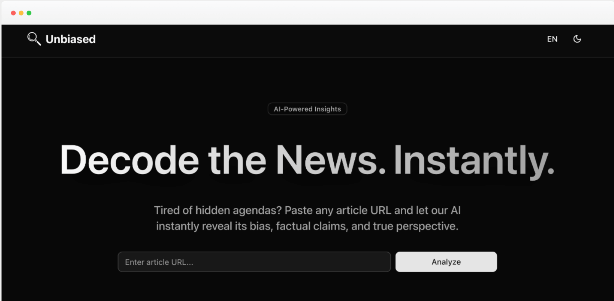

# Unbias: Article Analysis Tool

[](https://nextjs.org/)
[](https://www.typescriptlang.org/)
[](https://tailwindcss.com/)
[](https://nodejs.org/)
[](https://supabase.io/)
[](https://opensource.org/licenses/MIT)
[](https://unbias.app)

A web application that analyzes online articles for bias, factual claims, and perspective using AI.



## How it works

Unbias is a single Next.js app backed by one Supabase table (`jobs`).

```
browser ──POST /api/analyze──▶ Turnstile check → normalize URL
                                 ├─ finished or running analysis for this article + language? → return its id
                                 └─ otherwise insert a job → return its id, then run in the background (after()):
                                      1. preview from the publisher's meta tags
                                      2. fetch with Firecrawl (paywalled sites: newest archive.today snapshot)
                                      3. extract text with Readability
                                      4. analyze with the LLM (OpenAI, or any OpenAI-compatible API)
                                      5. store results on the row
browser ──▶ /[locale]/analysis/[id]   server-renders the row; refreshes every 2s until it is done
```

- **Every result has a shareable URL.** New, reused and shared analyses all render through the same page.
- **Articles are analyzed once per language.** If someone already analyzed (or is analyzing) the same article, a new submission is sent to that job instead of fetching and calling the LLM again. URLs are compared after normalization (https, no `www.`, no query string or fragment).
- **Paywalled publications** (`paywalledDomains` in `src/server/config.ts`) are only read from archive.today snapshots. If no snapshot exists, or it only holds a paywall preview (under 150 words), the job fails with a clear "try again later" message instead of analyzing a teaser.
- **Interrupted jobs** (no progress for 10 minutes, e.g. a deploy mid-analysis) are shown as failed, and the next submission starts over.
- **History** of opened analyses is kept in the browser's localStorage.
- **Bot protection** via Cloudflare Turnstile on submission (skipped in `next dev`).
- **Any LLM.** Analyses use OpenAI (`gpt-6.1-sol`) by default. To use another provider, set `OPENAI_BASE_URL` to its OpenAI-compatible endpoint (OpenRouter, Gemini, Anthropic, Mistral, Ollama, …), put its key in `OPENAI_API_KEY` and its model id in `LLM_MODEL_NAME`. See `.env.example`.

## Getting Started

Requires Node.js 22+.

```bash
npm ci
cp .env.example .env.local   # fill in Supabase, Firecrawl, OpenAI and Turnstile keys
npm run dev                  # http://localhost:3000
```

`npm test`, `npm run lint` and `npm run typecheck` cover the whole app.

## Deployment

One long-running Node process: `npm ci && npm run build`, then `npm start` (port 3000). Set the variables from `.env.example` on the host. Background analyses run inside this process, so it must not be a short-lived serverless function. No Redis, queue or separate worker is needed.

## Project Structure

```
src/
├── app/
│   ├── [locale]/page.tsx                  # home: form + history
│   ├── [locale]/analysis/[jobId]/page.tsx # result page (server-rendered from the jobs row)
│   └── api/analyze/route.ts               # the only API route
├── components/                            # UI (AnalyzeForm, AnalysisCard, Turnstile, …)
├── server/                                # server-only code
│   ├── jobs.ts       # reuse/dedup + row → page view
│   ├── pipeline.ts   # fetch → extract → analyze → store
│   ├── firecrawl.ts, contentExtractor.ts, metadata.ts
│   ├── llm.ts        # analysis prompt + OpenAI-compatible client
│   ├── db.ts, config.ts, urls.ts, turnstile.ts, logger.ts
├── i18n/, messages/                       # next-intl (en, de)
└── proxy.ts                               # locale detection and redirects
```

## Logging

`LOG_LEVEL` controls server logs, `NEXT_PUBLIC_LOG_LEVEL` browser logs. See [LOGGING.md](./LOGGING.md).

## License

This project is licensed under the **[MIT License](./LICENSE)**.
